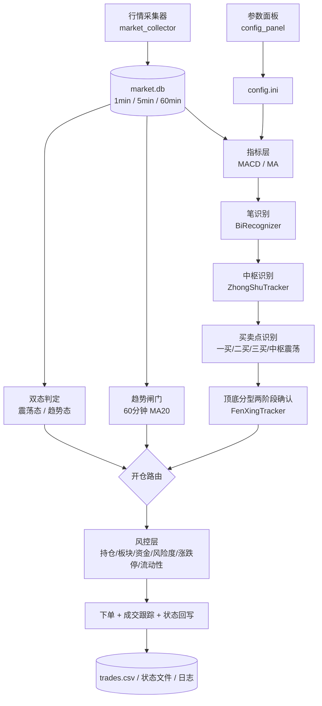

# 期货自动交易策略（TqSdk / 缠论结构 + 双态判定）

一个面向国内商品期货的自动化交易系统：**1 分钟做单、5 分钟判状态、60 分钟定方向**，以缠论的笔—中枢—买卖点为主干，配合两阶段分型确认与多层风控。

> 本项目为个人研究与工程实践作品，运行于模拟盘。代码与数据均不构成投资建议。

---

## 1. 一句话架构

```
行情采集器（独立进程） → 本地 SQLite 行情库 → 策略主循环 → 风控 → 下单
                                      ↑
              参数面板（GUI） → config.ini → 策略启动时加载
```

- **采集与交易解耦**：采集进程只负责落库，策略进程只读库，任一进程重启不影响另一个。
- **参数全部外置**：100+ 个参数集中在 `config.ini`，面板可视化编辑，改动不需要碰代码。
- **三级时间结构**：60 分钟定大方向 → 5 分钟判震荡/趋势 → 1 分钟触发下单。

### 数据流



---

## 2. 核心设计

### 2.1 笔与中枢（缠论口径）

- **笔识别**：以 MA20 划分涨跌段，连续 4 根收盘穿越确认新段、锁定上一笔，单笔至少 6 根 K 线。选 MA20 而非分型笔，是因为实测在 5 分钟级别上分型笔会把箱体切得更碎（见下节“结构量化”）。
- **中枢识别**：取最近三笔，方向交替且区间重叠时成立；`ZD = max(三笔低点)`、`ZG = min(三笔高点)`，并支持**延伸**（段数累加、区间合并）与**扩展**（段数达阈值视作级别升级，旧区间作废 + 冷却）。
- **状态推进的收敛性**：用“最近三笔的取值签名”去重，只有结构真的变了才推进状态机——修掉了早期“每 12 分钟定时重建中枢”的假信号。

### 2.2 双态判定（震荡 / 趋势）

- 价格在 5 分钟中枢箱体内 → 震荡态，走“位置 + 分型确认”的博弈型开仓；
- 跌破/升破箱体 → 进入突破候选，用“新回抽笔是否回箱体”区分假突破（拉回震荡）与真离开（趋势态）；
- 突破后已远离超过 `N × 箱体高度` → 直接判趋势态，不再低吸高抛。

### 2.3 顶底分型两阶段确认

所有买卖点都必须等分型确认：先把信号挂起 → 从第 3 根 K 线起，任一根收盘突破锚点才执行 → 期间跌破分型极值则作废。规则是“没有底分型哪来的底”的落地。

### 2.4 风控（多层）

单品种手数上限、板块持仓上限、可用资金比例、单笔风险占比、涨跌停距离、盘口流动性、收盘/夜盘前禁止开新仓、收盘前强平、挂单超时撤单重报。

### 2.5 工程细节

- 配置读写：自动生成带中文注释的 ini 模板，缺项/类型错误自动回退出厂默认，不会导致启动失败；
- 日志：按大小滚动，关键事件（开平仓、异常、心跳）分级打印 + 可选微信推送；
- 状态：持仓状态持久化到文件，进程重启后能恢复；
- 异常：主循环 try/except 包裹，单品种异常不影响其他品种。

---

## 3. 研究方法（本项目更重要的部分）

策略研究不是“调参到赚钱”，而是一套可复现的验证流程：

1. **数据准备**：本地行情库按 1/5/60 分钟分别落库，回放时严格只用已收盘 K 线，避免未来函数。
2. **成交还原**：平仓行缺少开仓时间，按 FIFO 配对还原每一笔的完整生命周期；剔除午休空档导致的错误强平。
3. **滑点归一**：回放结果与实盘系统性偏差约 2.6 点，统一扣 2.5 点后再比较，保证“相对比较”可信。
4. **分层归因**：不是看总盈亏，而是按开仓类型拆开——发现震荡博弈模块贡献了绝大部分亏损，而确认型信号是正贡献。
5. **结构量化**：用全品种历史数据统计笔端点误差、中枢宽度分布，验证“窄箱体”到底是笔的问题还是级别的问题。
6. **过拟合自查**：参数网格搜索里出现“全样本很好、验证段崩掉”的组合直接弃用；对样本量给出置信区间，不用 20 笔样本下结论。

### 一个具体的归因结论

| 开仓类型 | 笔数 | 胜率 | 合计盈亏 |
|---|---|---|---|
| 震荡低吸 / 高抛 | 61 | 41% | **显著为负** |
| 确认型（二买/二卖/三买/三卖） | 38 | 52.6% | **为正，PF > 1.5** |

结论：**砍掉震荡模块，保留确认型**，并给中枢加一条“最小有效宽度”门槛，防止窄箱体再次产生交易。

### 结构量化（顺带得到的副产品）

同一批全品种历史数据、5 分钟级别：

| 笔的定义 | 笔数 | 中枢中位宽度 | ≤10 点占比 |
|---|---|---|---|
| MA20 笔（现用） | 5870 | 13 点 | 41.9% |
| 缠论分型笔（严格） | 7210 | 9 点 | 56.4% |
| 缠论分型笔（宽松） | 3784 | 17 点 | 29.7% |
| **30 分钟级别（MA20）** | 1042 | **28 点** | 10.4% |

结论：箱体过窄不是“笔算错了”，而是**级别**决定的——换笔只能从 13 点挪到 17 点，升到 30 分钟级别才能到 28 点。所以正确的修法是“提高箱体判定级别 / 加有效宽度门槛”，不是重构笔。

---

## 4. 结果与局限

> 以下为模拟盘（sim）数据，样本 41 个交易日、99 笔平仓。
> 归因后保留的“确认型”信号子样本：38 笔，胜率 52.6%，盈亏比 1.55，单笔正期望。
> **局限**：样本量偏小，胜率 95% 置信区间约 ±15 个百分点；结论仅用于策略取舍，不构成收益承诺。

<!-- 如不希望公开具体数字，可整节删除 -->

---

## 5. 目录结构（私有仓库）

```
.
├── zszf1_strategy.py       # 主策略（1 分钟主循环 + 结构识别 + 风控 + 下单）
├── config_loader.py        # 配置加载 / 模板生成 / 取值校验
├── config_panel.py         # Tkinter 参数面板：编辑、保存、启停、看日志
├── market_collector.py     # 独立行情采集进程
├── replay_zhongshu.py      # 离线回放：验证中枢识别
├── zszf1_backtest.py       # 离线回测引擎
├── trade_stats.py          # 成交统计
├── config.example.ini      # 脱敏配置模板（真实 config.ini 不入库）
└── requirements.txt
```

---

## 6. 免责声明

本项目仅用于个人学习与技术研究，不构成任何投资建议。期货交易风险极高，实盘盈亏自负。项目依赖 [TqSdk](https://www.shinnytech.com/) 提供的行情与交易接口，使用须遵守其服务条款。
